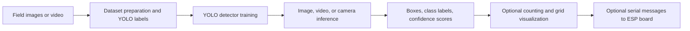
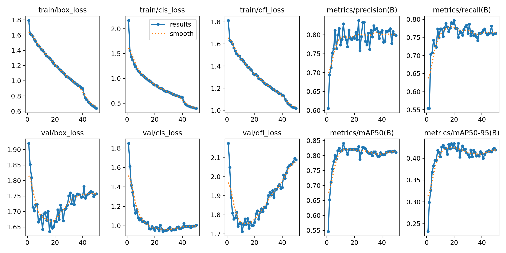
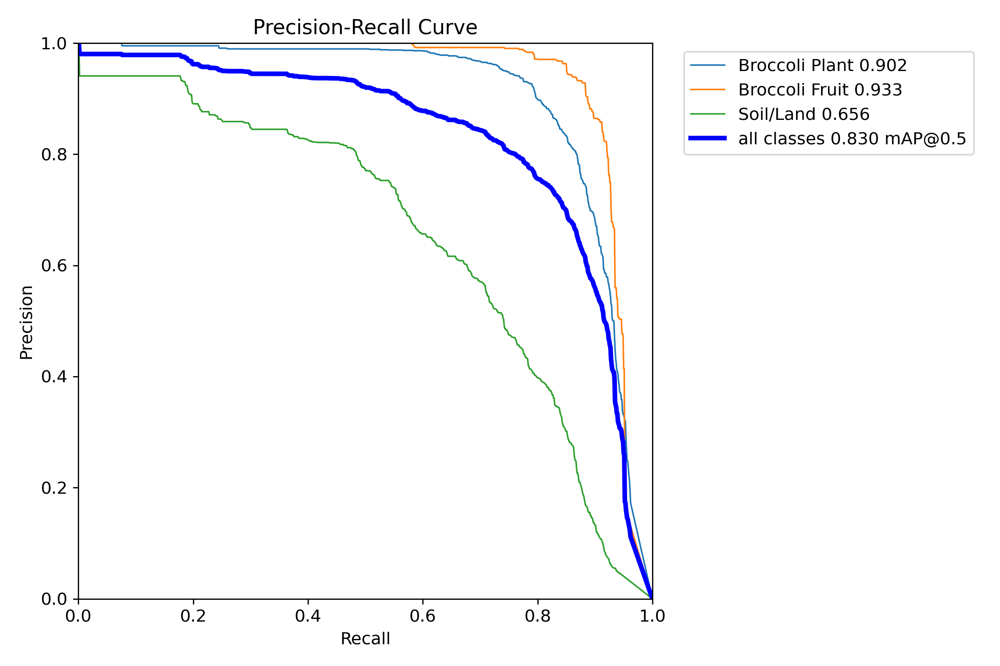
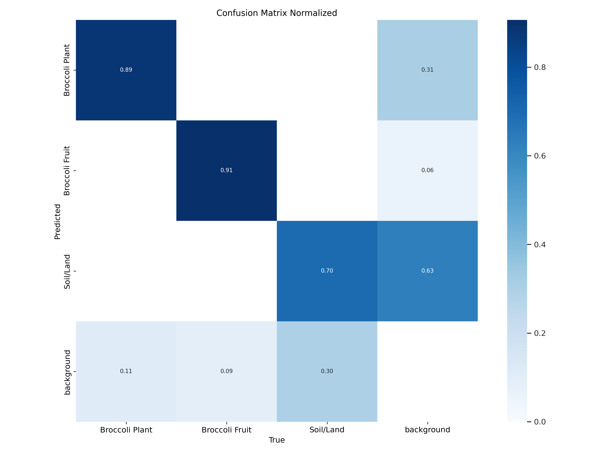
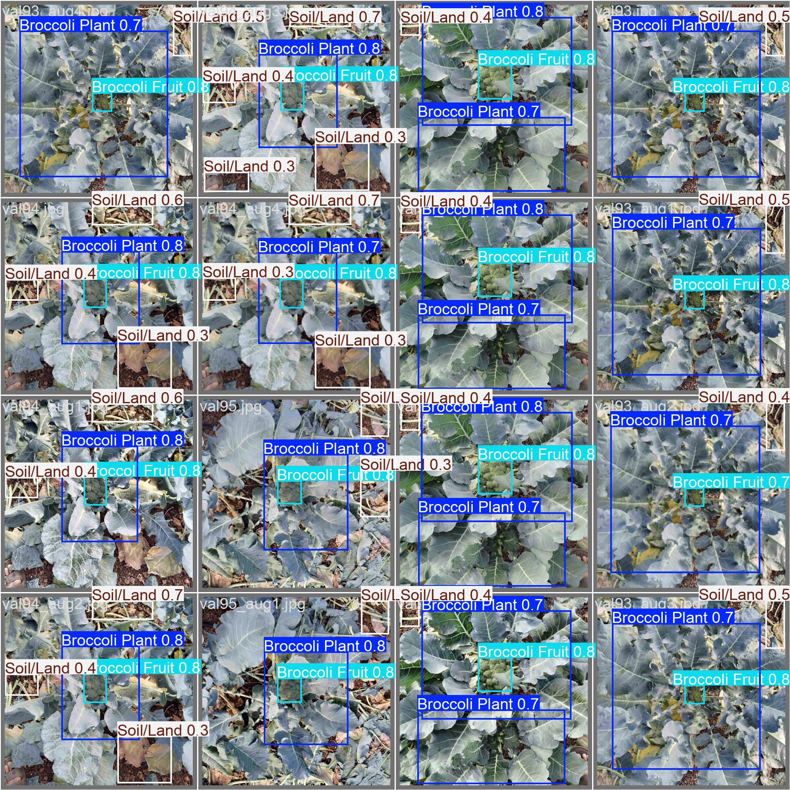
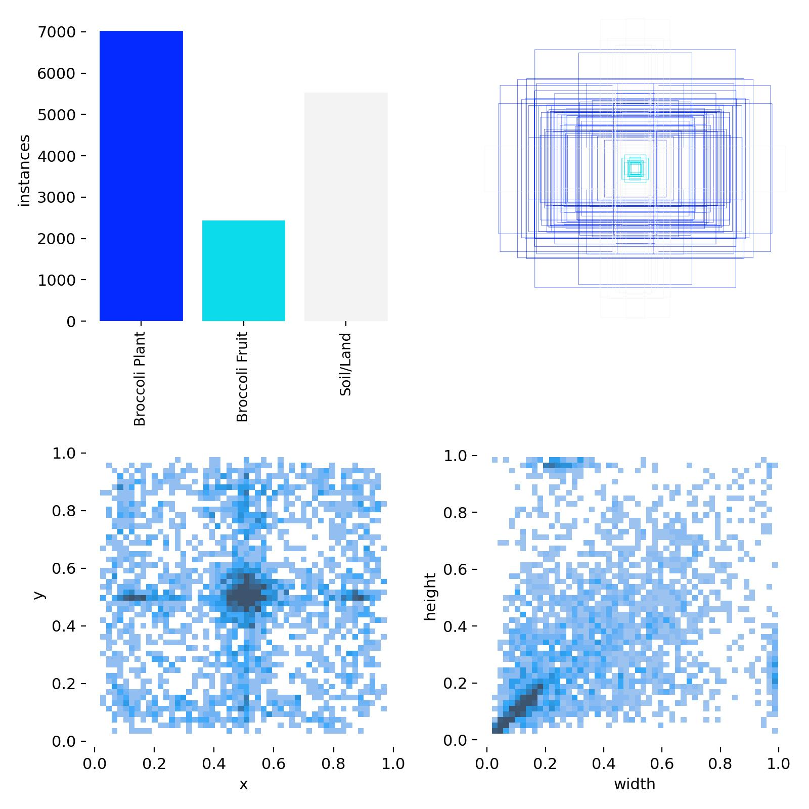
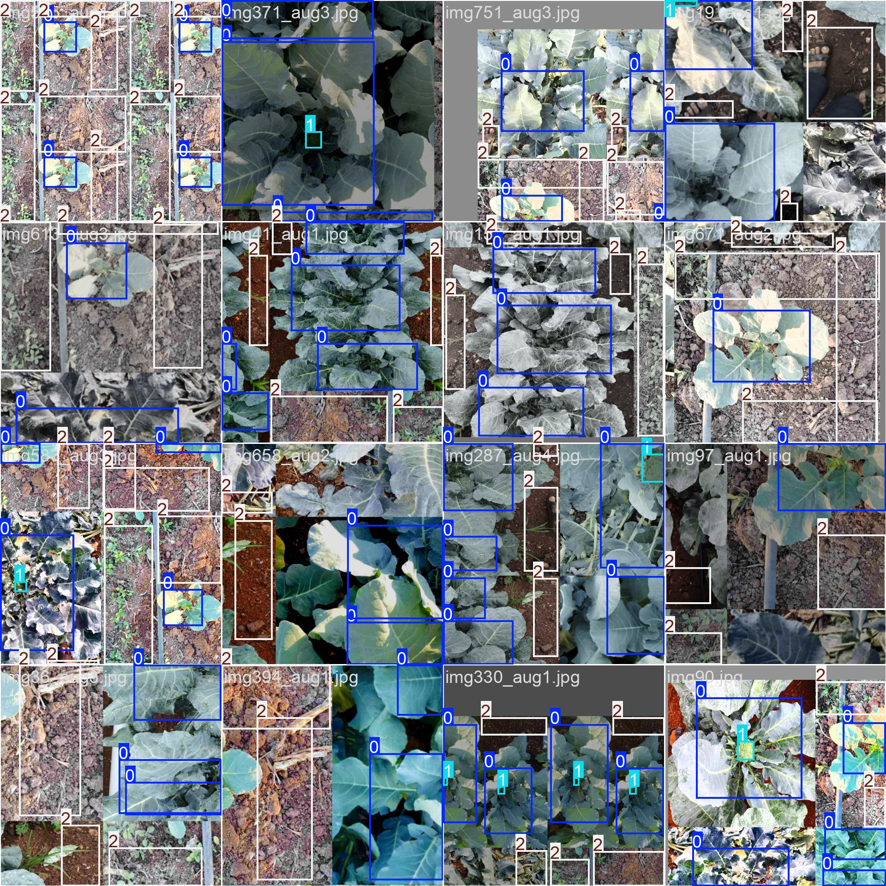
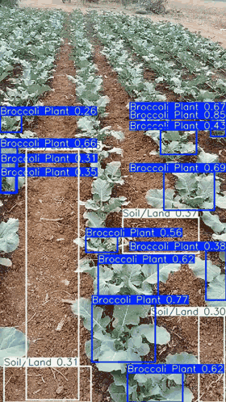

# APS Agro: Broccoli Detection and Field-Lane Perception

APS Agro is an experimental computer-vision repository for agricultural field monitoring. Its primary workstream detects broccoli plants, broccoli heads, and soil/land in field imagery. Related work explores crop-row and path detection, image/label preparation, video inference, and an ESP32-CAM prototype.

The repository contains several independent experiments rather than one integrated, release-ready application. This README describes the recorded methods and artifacts, provides a starting point for inference, and distinguishes observed results from claims that the available evidence cannot support.

## Research scope

The work represented here has three related objectives:

1. **Broccoli scene detection:** localize broccoli plants, broccoli fruit/heads, and soil/land in images and video using YOLO object detectors.
2. **Field-row perception:** explore detection and segmentation of crop rows and paths using YOLO, LaneNet/U-Net, and DeepLab-style experiments.
3. **Field monitoring prototypes:** process recorded or streamed video, display detections, estimate counts, draw a simple image-space grid, and send serial messages to an ESP board.

These are separate workstreams. The repository does not currently define a single end-to-end system joining lane localization, plant counting, GPS coordinates, and a calibrated field map.

### Broccoli detector classes

The three-class configuration in `Final_Broccolli_Detection_ML/YOLO_Dataset/data.yaml` defines:

| Class ID | Class name |
| ---: | --- |
| 0 | Broccoli Plant |
| 1 | Broccoli Fruit |
| 2 | Soil/Land |

The label-distribution plot indicates a class imbalance: plant labels are most frequent and fruit labels least frequent. The repository does not include a dataset card documenting collection sites, dates, camera setup, annotation protocol, or the exact image counts represented by each split.

### Lane-detection classes

The YOLO lane configuration defines three classes: **Main Row**, **Adjacent Row**, and **APS Path**. Other lane experiments explore semantic masks and U-Net/LaneNet or DeepLab variants. Their source, data, and outputs are spread across `lane detection brc/` and `final_Broccoli_Lane_detection_ML/`.

## System outline



The grid prototype maps pixel coordinates from a camera frame to a fixed 800 × 800 display. It is an image-space visualization; no camera calibration, ground-plane transform, or geographic coordinate registration is implemented in the inspected counting scripts. Counts should therefore be treated as prototype estimates, not field-survey measurements.

## Recorded results

The values below are read from the checked-in Ultralytics `results.csv` files. Precision, recall, and mAP are the logged **validation** metrics for those runs. They are not results on a documented, independent test set.

| Experiment | Logged epochs | Precision | Recall | mAP@0.50 | mAP@0.50:0.95 |
| --- | ---: | ---: | ---: | ---: | ---: |
| Broccoli detector v1.0, final logged epoch | 50 | 0.7981 | 0.7615 | 0.8108 | 0.4193 |
| Lane YOLO run, final logged epoch | 100 | 0.5157 | 0.5351 | 0.5236 | 0.2376 |

For broccoli v1.0, the highest recorded mAP@0.50:0.95 in the CSV is **0.4341 at epoch 23**; the final epoch value is 0.4193. The PR curve saved with that run reports class AP@0.50 values of 0.902 for Broccoli Plant, 0.933 for Broccoli Fruit, and 0.656 for Soil/Land, with aggregate mAP@0.50 of 0.830. These are values from the saved run artifacts and should be interpreted with the split and provenance limitations below.

| Training curves | Precision–recall curve |
| --- | --- |
|  |  |

| Normalized validation confusion matrix | Example validation predictions |
| --- | --- |
|  |  |

The `trained_model2.0/fine_tuned_model_broccoli2.0` log contains two epoch rows, although its saved arguments specify a 25-epoch run. The sibling `fine_tuned_model_broccoli2.02` log contains one epoch row. These records are incomplete and are not presented as final fine-tuning results. Their saved arguments both point to the v1.0 `best.pt` as the starting checkpoint; the artifacts do not establish a sequential v2.0-to-v2.02 fine-tuning chain.

### Qualitative examples and exported video

The following plots show the three-class label distribution and examples of training annotations. They are useful for inspecting labels and augmentations, but do not measure generalization.

| Label distribution and box geometry | Training batch with YOLO boxes |
| --- | --- |
|  |  |

An additional augmented training batch is available as [train_batch2.jpg](docs/results/train_batch2.jpg).

[](docs/results/output_annotated3.mp4)

The embedded GIF is a 5-second, looping preview. Click it to open the full `output_annotated3.mp4`, which is approximately 10 seconds long (303 frames at 30 fps, 478 × 850). It overlays detections and confidence scores. Other saved examples are [output_annotated4.mp4](docs/results/output_annotated4.mp4), [output_annotated5.mp4](docs/results/output_annotated5.mp4), and [output_with_grid_map.mp4](docs/results/output_with_grid_map.mp4). The videos demonstrate visual output only; they do not establish detection accuracy, counting accuracy, or real-time performance on a specified device.

## Repository map

| Path | Contents |
| --- | --- |
| `Dataset/` | Image annotation, augmentation, crop/resize, split utilities, a legacy YOLOv5 training script, and an image/video/webcam inference script |
| `Final_Broccolli_Detection_ML/` | Broccoli dataset/configuration and YOLO experiment runs, including training arguments, logs, weights, curves, and validation examples |
| `lane detection brc/` | Lane imagery/labels, YOLO configs and runs, and segmentation experiments |
| `final_Broccoli_Lane_detection_ML/` | Additional lane annotation, preprocessing, GPS-related spreadsheets/scripts, and experiments |
| `HardwareSetup/` | ESP32-CAM stream inference and serial-based counting prototypes |
| `SelfLearn/` | Additional labeled images and self-learning experiments |
| `Colab Notebooks/` | Notebook-based preprocessing and training workflow |
| `docs/results/` | Curated visual artifacts and exported demonstration videos referenced by this README |
| `best.pt` | Root-level model loaded by `Dataset/test.py` when run from the repository root |

The project includes substantial image, video, and model artifacts. Directory names and capitalization reflect the current repository and include historical spellings such as `Broccolli`.

## Inference

The most direct included interactive inference script is `Dataset/test.py`. It loads `best.pt` from the current working directory and offers image, webcam, and video modes. It uses a desktop file picker and OpenCV display windows.

Create an environment with Python and install the packages used by that script:

```bash
python -m venv .venv
# Windows PowerShell:
.venv\Scripts\Activate.ps1
# macOS/Linux:
source .venv/bin/activate

python -m pip install --upgrade pip
python -m pip install ultralytics opencv-python matplotlib
```

Run it from the repository root so the relative model path resolves:

```bash
python Dataset/test.py
```

Choose `1` for an image, `2` for the default webcam, or `3` for a video. Press **q** to stop webcam/video display. Image predictions are displayed and saved by the Ultralytics result object; video predictions are displayed but the script does not write an annotated video file.

For GPU inference, install a PyTorch build compatible with the local CUDA setup before installing or using Ultralytics. The repository does not pin Python, PyTorch, Ultralytics, CUDA, or OpenCV versions, so exact environment reproduction is not currently guaranteed.

## Training and data preparation

### Dataset format

The broccoli detector uses the Ultralytics/YOLO object-detection convention: an image and a same-basename text label file containing one normalized `class_id x_center y_center width height` box per line. The recorded v1.0 arguments specify 640-pixel input, batch size 16, 50 epochs, seed 0, and validation during training. The v1.0 run's `args.yaml`, `results.csv`, weights, and diagnostic figures are under:

```text
Final_Broccolli_Detection_ML/YOLO_Dataset/trained_model1.0/broccoli_model/
```

The fine-tuning records are under `Final_Broccolli_Detection_ML/YOLO_Dataset/trained_model2.0/`. Saved `args.yaml` files contain paths from Google Colab/Drive. Update the `data` and `model` paths before attempting to reproduce a run.

### Configuration and reproducibility cautions

- The root `data.yaml` and `Final_Broccolli_Detection_ML/data.yaml` each declare `nc: 1` but list three class names. The broccoli experiment-specific configuration at `Final_Broccolli_Detection_ML/YOLO_Dataset/data.yaml` correctly declares three classes, but its train/validation paths are absolute Colab paths.
- `Dataset/train_yolo.py` is a legacy YOLOv5 entry point with a hard-coded Python package path from one Windows machine. It reads the root `data.yaml`; as checked in, it is not a portable reproduction of the later Ultralytics runs.
- The lane YOLO YAML and some training code also contain absolute Colab or Windows paths. Repoint them to the local image and label directories before use.
- `Dataset/partition.py` shuffles with Python's unseeded global random state, copies files into train/validation folders, and warns when a label file is missing. It does not stratify by class or group related frames by source video. If neighboring frames or augmented derivatives cross splits, validation metrics may be optimistic.
- The inspected annotation utility draws on a resized 800 × 600 preview and normalizes box coordinates using that display size. It should be checked before using it to generate labels for images with other aspect ratios.
- Augmentation and preprocessing scripts contain hard-coded local paths and assumptions. Inspect each script before running it, and keep augmented variants of a source image within the same data split.

For a defensible new experiment, record dataset version and provenance, class mapping, source-level train/validation/test split, random seeds, package and hardware versions, model checkpoint, and all inference thresholds. Reserve a test split that is not used for training or model selection, and report per-class as well as aggregate metrics.

## Lane and hardware experiments

The lane YOLO run uses three classes (Main Row, Adjacent Row, APS Path), a YOLOv8n checkpoint, 640-pixel input, batch size 16, and 100 configured epochs. Its saved CSV contains 100 validation rows. The corresponding run artifacts—including `args.yaml`, `results.csv`, PR and confusion-matrix plots, and validation predictions—are under:

```text
lane detection brc/new test/Traning_Test/yolo/output/yolo_lane_detection/
```

LaneNet/U-Net and DeepLab-related scripts are experimental alternatives; their dependencies, input masks, and data paths differ. No unified evaluation protocol across these approaches is documented.

The ESP32 scripts in `HardwareSetup/esp32/` read a configured camera stream, run YOLO, and may send `PLANT` or `FRUIT` serial commands. They embed example network URLs, serial port settings, and model paths. Edit those values for the local camera, board, and checkpoint. These scripts are hardware prototypes; the repository does not include firmware, a wiring specification, or a calibrated counting validation.

## Limitations and research status

The repository is valuable as a record of data preparation, model experiments, and prototype outputs. The available evidence is not sufficient to support a general claim of field-ready performance because:

- dataset provenance, collection conditions, annotation guidance, and exact split membership are not documented;
- no independent held-out test set or repeated-seed evaluation is identified;
- class frequency is imbalanced, and the PR artifact shows lower AP for Soil/Land than for the two broccoli classes;
- fine-tuning logs are incomplete, and training software versions are not pinned;
- several training and hardware scripts use machine-specific paths and settings;
- video examples have no ground-truth tracks or validated counting scores; and
- the image-space grid is not a calibrated map of physical field coordinates.

No `LICENSE` file or citation metadata is present in the repository snapshot. Add dataset and model provenance, attribution, and licensing information before redistributing the data or presenting the work as a reproducible benchmark.

## Acknowledgements and citation

No formal paper, author list, or citation entry is included in the repository. If this work is used in a report or publication, cite the specific repository revision and identify the dataset, checkpoint, configuration, and validation split used. Do not cite the demonstration videos as quantitative evaluation.
